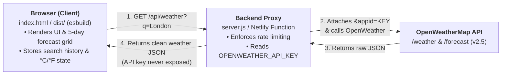

# Weather Forecast Web App

A responsive, full-stack weather dashboard built with HTML5, modular CSS3, Vanilla JavaScript, an `esbuild` asset pipeline, and a zero-dependency Node.js / Netlify serverless proxy using the OpenWeatherMap API. Features GPS location detection, unit conversion (`°C`/`°F`), coordinate-based search history in `localStorage`, and a 100/100 Lighthouse score.

## Live Demo

- **Live Site:** [https://evancru-weather-app.netlify.app](https://evancru-weather-app.netlify.app) *(Update with your Netlify URL)*

## Key Features

- **Secure API Proxy & Rate Limiting:** Hides your `OPENWEATHER_API_KEY` on the backend (`server.js` locally and `netlify/functions/weather.js` in production) while enforcing a sliding-window rate limit (30 requests/minute).
- **Real-Time & 5-Day Forecast:** Displays current metrics and a daily midday 5-day grid via responsive CSS Grid.
- **Coordinate-Based History & GPS:** Saves recent searches with `lat`/`lon` coordinates to eliminate city name ambiguity, alongside one-click browser geolocation.

## Architecture & Request Flow



1. **Client Request:** The browser requests `/api/weather` or `/api/forecast` without exposing credentials.
2. **Server Proxy:** The backend checks rate limits, injects `OPENWEATHER_API_KEY` from environment variables, and queries OpenWeatherMap.
3. **Response & Render:** Data flows back through the proxy to update the DOM and `localStorage` cache.

## Project Structure

```text
weather-app/
├── index.html                  # Semantic HTML5 markup & LCP image hints
├── server.js                   # Local Node.js API proxy, rate limiter & static server
├── netlify.toml                # Netlify build & API redirect configuration
├── netlify/
│   └── functions/
│       └── weather.js          # Serverless OpenWeather proxy for Netlify
├── styles/                     # Modular CSS partials (variables, weather, forecast, main)
├── scripts/                    # Vanilla JS modules (api, storage, render, main)
├── dist/                       # Production build output (generated by esbuild)
├── .env                        # Local environment variables (.gitignore excluded)
├── .gitignore                  # Excludes .env, node_modules, and .netlify
├── package.json                # Build scripts (esbuild) and dependencies
└── README.md                   # Project documentation
```

## Getting Started (Local Development)

1. **Clone & Install:**
   ```bash
   git clone https://github.com
   cd weather-app
   npm install
   ```
2. **Configure Environment:** Create a `.env` file in the root directory:
   ```env
   OPENWEATHER_API_KEY=your_openweather_api_key_here
   ```
3. **Build & Run:**
   ```bash
   npm run build
   node --env-file=.env server.js
   ```
   Open `http://localhost:3000`.

## Deployment (Netlify)

Configured for continuous deployment on **Netlify** via GitHub:
- **Build command:** `npm run build`
- **Publish directory:** `.` (root)
- **Environment variable:** Set `OPENWEATHER_API_KEY` in **Site configuration → Environment variables**

## Author

**EvanCru** — [cuduco_19@hotmail.com](mailto:cuduco_19@hotmail.com)