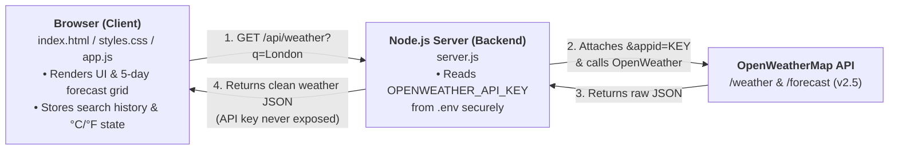

# 🌦️ Weather Forecast Web App

A responsive, full-stack weather dashboard built with **HTML5, CSS3, Vanilla JavaScript, and a lightweight Node.js proxy server** using the [OpenWeatherMap API](https://openweathermap.org). Users can search for any city worldwide, detect their local weather via GPS, switch seamlessly between Celsius and Fahrenheit, and revisit recent locations stored locally in the browser—all while keeping the API key securely hidden on the server.

## ✨ Key Features

- **Secure Node.js Proxy Server:** Uses a zero-dependency Node.js backend (`server.js`) to inject `OPENWEATHER_API_KEY` from environment variables on the server side, keeping credentials completely hidden from both version control and the browser's Network tab.
- **Real-Time Current Weather:** Displays temperature, weather condition descriptions, condition icons, humidity, and wind speed in metric units (`°C`, `m/s`).
- **5-Day Multi-Card Forecast:** Uses the OpenWeather 5-day / 3-hour forecast endpoint filtered to daily midday snapshots in a responsive CSS Grid layout.
- **Instant Unit Conversion (`°C` / `°F`):** Toggles temperature units across both current conditions and the 5-day forecast instantaneously without making redundant API calls.
- **Coordinate-Based Search History (`localStorage`):** Saves the last 5 searched locations with city names, country codes, and exact geographic coordinates (`lat` / `lon`) to prevent ambiguity between cities sharing the same name across different countries.
- **GPS Location Detection:** Uses the browser's Geolocation API (`navigator.geolocation`) to fetch local weather conditions with one click.
- **Resilient Fetch with Retry Backoff:** Automatically retries transient network or server failures with increasing backoff delays while failing fast on invalid city queries (`404`) or authentication errors (`401`).
- **Responsive & Accessible UI:** Built with semantic HTML, ARIA live regions for screen readers, and flexible CSS layouts that adapt cleanly across desktop and narrow mobile viewports.

## 🏗️ Architecture & Request Flow

To keep the OpenWeatherMap API key completely hidden from the browser, the app uses a lightweight **Node.js proxy server (`server.js`)** between the frontend client and the external API:


### How a Request Flows
1. **Client Request:** The browser (`app.js`) requests `/api/weather` or `/api/forecast` from the local Node server with only the city name or coordinates—no API key is ever sent from the client.
2. **Server Proxy Injection:** `server.js` intercepts the `/api/*` route, reads `OPENWEATHER_API_KEY` from the server's `.env` environment variables, and forwards the request to OpenWeatherMap.
3. **External Response:** OpenWeatherMap validates the key and returns the weather or 5-day forecast JSON to the Node server.
4. **Client Rendering:** `server.js` forwards the JSON response back to `app.js`, which updates the DOM, caches the location coordinates in `localStorage`, and renders the 5-day forecast grid.


## 🛠️ Tech Stack

- **Frontend:** HTML5, CSS3 (Flexbox & CSS Grid), Vanilla JavaScript (ES6+, `async/await`, Fetch API)
- **Backend / Proxy:** Node.js (built-in `http`, `fs`, and `path` modules — zero external dependencies)
- **APIs:** OpenWeatherMap Current Weather API & 5-Day Forecast API, Browser Geolocation API & `localStorage`

## 🚀 Getting Started

### Prerequisites
- [Node.js](https://nodejs.org) v20.6+ (for native `--env-file` and built-in `fetch` support)
- A free API key from [OpenWeatherMap](https://openweathermap.org)

### 1. Clone the Repository
```bash
git clone https://github.com
cd YOUR_REPO_NAME
```

### 2. Configure Your Environment Variable
Create a `.env` file in the root directory (ignored by `.gitignore`) and add your OpenWeather API key:

```env
OPENWEATHER_API_KEY=your_openweather_api_key_here
```

### 3. Start the Server
Run the Node.js proxy and static file server:

```bash
node --env-file=.env server.js
```

Then open **`http://localhost:3000`** in your browser.

## 📂 Project Structure

```text
├── server.js           # Zero-dependency Node.js API proxy & static file server
├── index.html          # Semantic markup and ARIA regions
├── styles.css          # Responsive Flexbox & CSS Grid styling
├── app.js              # Frontend state, retry logic, geolocation, and DOM rendering
├── .env                # Local environment variables (excluded via .gitignore)
├── .gitignore          # Excludes .env and local secrets from Git tracking
└── README.md           # Project documentation
```
